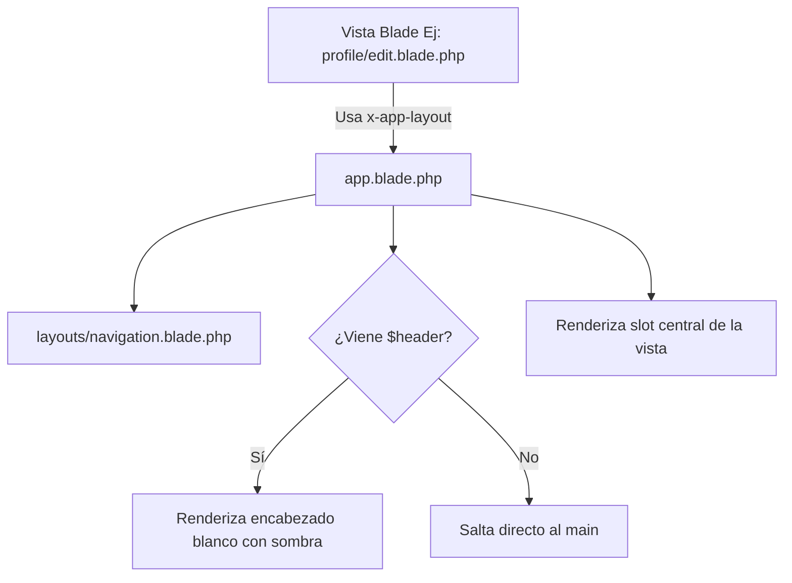

# Documentación Técnica: Layout Principal Base (`app.blade.php`)

> **Autor:** Karen Galeano  
> **Ubicación:** `resources/views/layouts/app.blade.php`  
> **Propósito:** Plantilla maestra base generada con Laravel Breeze utilizada para vistas de administración general, configuraciones de perfil y módulos estándar del ecosistema.

---

## 1. ¿Qué es este archivo y por qué lo diseñé así? (En mis palabras)

Este archivo representa la **plantilla maestra predeterminada de mi aplicación**. Lo utilizo principalmente como layout contenedor cuando renderizo componentes Blade estándar (como las vistas de edición de perfil o interfaces genéricas del sistema). 

Su propósito es proveer una estructura HTML5 limpia, moderna y reactiva que incluye:
1. Las etiquetas `<head>` fundamentales con soporte para tokens de seguridad CSRF y títulos dinámicos.
2. La carga de tipografías optimizadas desde Bunny Fonts (`Figtree`).
3. La integración con **Vite** para procesar mis hojas de estilo compiladas (`app.css`) y lógica de JavaScript (`app.js`).
4. El llamado a mi barra de navegación global superior (`layouts.navigation`).
5. Un contenedor flexible con slots para inyectar tanto el encabezado de página (`$header`) como el cuerpo central (`$slot`).

---

## 2. Desglose y Explicación Detallada de Todo el Código

### A. Estructura Inicial del Documento HTML y Etiquetas Meta
Aquí defino el doctype, el idioma dinámico del sistema y las etiquetas indispensables del `<head>`:

```blade
<!DOCTYPE html>
<html lang="{{ str_replace('_', '-', app()->getLocale()) }}">
    <head>
        <meta charset="utf-8">
        <meta name="viewport" content="width=device-width, initial-scale=1">
        <meta name="csrf-token" content="{{ csrf_token() }}">

        <title>{{ config('app.name', 'Laravel') }}</title>
```

**¿Cómo funciona y por qué lo programé así?:**
- `lang="{{ str_replace('_', '-', app()->getLocale()) }}"`: Convierte el formato de locale de Laravel (ej. `es_ES` o `es_CO`) al estándar HTML con guion (`es-CO` o `es`), asegurando una adecuada interpretación en navegadores y motores de búsqueda.
- `<meta name="viewport" ...>`: Garantiza que la página se adapte fluidamente a pantallas de dispositivos móviles, tablets y escritorios (`width=device-width, initial-scale=1`).
- `<meta name="csrf-token" content="{{ csrf_token() }}">`: Genera el token CSRF indispensable para que mis peticiones AJAX y Fetch API desde JavaScript puedan interactuar con mis controladores sin ser bloqueadas por el middleware `VerifyCsrfToken`.
- `<title>{{ config('app.name', 'Laravel') }}</title>`: Obtiene el nombre oficial del sistema configurado en mi `.env` (`LashApp`), mostrando un fallback seguro a `'Laravel'` si no estuviera definido.

---

### B. Carga de Tipografías y Compilación de Assets con Vite
En esta sección conecto la tipografía `Figtree` y compilo mis recursos modernos:

```blade
        <!-- Fonts -->
        <link rel="preconnect" href="https://fonts.bunny.net">
        <link href="https://fonts.bunny.net/css?family=figtree:400,500,600&display=swap" rel="stylesheet" />

        <!-- Scripts -->
        @vite(['resources/css/app.css', 'resources/js/app.js'])
    </head>
```

**¿Cómo funciona y por qué lo programé así?:**
- `preconnect` a `fonts.bunny.net`: Optimiza la velocidad de carga estableciendo una conexión anticipada con el CDN que provee la tipografía `Figtree`, un reemplazo respetuoso de la privacidad y de alto rendimiento frente a Google Fonts.
- `@vite([...])`: Es la directiva nativa de Laravel que inyecta automáticamente los enlaces a los archivos CSS y JS procesados por Vite en modo desarrollo con HMR (Hot Module Replacement) o minificados para producción.

---

### C. Cuerpo de la Página, Navegación y Encabezado Dinámico (`$header`)
Aquí abro el `<body>` con las clases tipográficas de Tailwind, incluyo la barra de navegación y conditionalmente renderizo el título o encabezado de la página:

```blade
    <body class="font-sans antialiased">
        <div class="min-h-screen bg-gray-100">
            @include('layouts.navigation')

            <!-- Page Heading -->
            @isset($header)
                <header class="bg-white shadow">
                    <div class="max-w-7xl mx-auto py-6 px-4 sm:px-6 lg:px-8">
                        {{ $header }}
                    </div>
                </header>
            @endisset
```

**¿Cómo funciona y por qué lo programé así?:**
- `class="font-sans antialiased"`: Aplica la fuente sans-serif configurada y activa el suavizado de fuentes en WebKit/macOS para máxima legibilidad.
- `min-h-screen bg-gray-100`: Crea un contenedor que siempre cubre como mínimo el 100% de la altura del viewport (`100vh`), pintándolo de un gris claro neutro que hace resaltar el contenido.
- `@include('layouts.navigation')`: Inserta mi barra de navegación estándar con dropdowns y soporte responsive para móviles.
- `@isset($header)`: Evalúa si la vista hija definió una sección `<x-slot name="header">`. Si existe, renderiza un encabezado blanco con sombra sutil (`shadow`) y un ancho máximo centrado (`max-w-7xl mx-auto`). Si la vista no necesita encabezado, este bloque simplemente no ocupa espacio.

---

### D. Slot de Contenido Principal y Cierre de Etiquetas
Finalmente, defino el punto exacto donde se renderiza todo el contenido dinámico de cada vista que invoque a este layout:

```blade
            <!-- Page Content -->
            <main>
                {{ $slot }}
            </main>
        </div>
    </body>
</html>
```

**¿Cómo funciona y por qué lo programé así?:**
- `<main>{{ $slot }}</main>`: Es el núcleo del componente Blade. Cualquier vista que utilice `<x-app-layout>` inyectará todo su marcado HTML dentro de esta etiqueta semántica `<main>`, manteniendo la coherencia de estructura en toda mi plataforma.

---

## 3. Resumen de Flujo de Datos


